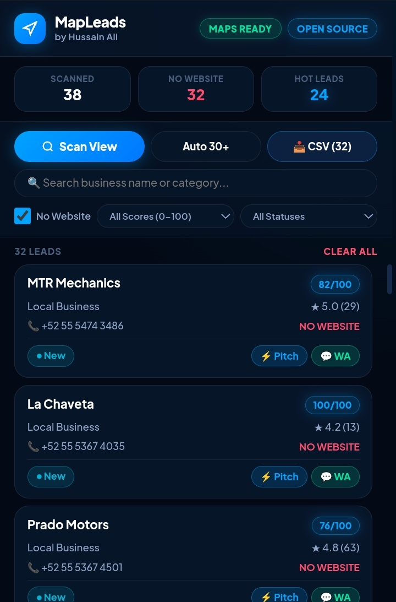

# MapLeads — Find Local Businesses Without Websites

MapLeads is a free, open-source Chrome extension that helps freelancers, web developers, and agencies find potential clients through Google Maps.

It scans business listings, identifies businesses without a listed website, and helps you organise them into a lead list.

I built it to make finding potential web development clients a little less manual.

<!-- INSERT YOUR SCREENSHOT HERE -->

## What it does

- **Google Maps Scanning:** Scan business listings for any niche or location (e.g., plumbers in London or restaurants in New York).
- **No-Website Filter:** Find businesses that don't have a website listed on their Google Maps profile.
- **Automatic Scrolling:** Automatically scroll through Google Maps results to load more business listings.
- **Lead Scoring:** Assign scores out of 100 based on factors such as ratings, reviews, and website status to help prioritise leads.
- **WhatsApp Pitch Generator:** Generate business outreach messages in 24 languages, including English, Roman Urdu, and Spanish.
- **CSV Export:** Export your filtered leads into a CSV file for further use.

## Installation

MapLeads can be installed locally through Chrome's Developer Mode.

1. Download this repository using the green **Code** button → **Download ZIP**.
2. Extract the downloaded ZIP file.
3. Open Google Chrome and visit `chrome://extensions/`.
4. Enable **Developer mode**.
5. Click **Load unpacked**.
6. Select the extracted MapLeads project folder.
7. Open Google Maps and search for businesses in your target niche or location.
8. Open MapLeads and start scanning.

## Example use case

Imagine you're a freelance web developer looking for potential clients in London. Instead of manually opening hundreds of Google Maps listings:

1. Search for a business category on Google Maps.
2. Open MapLeads and scan the results.
3. Filter businesses without a listed website.
4. Review their ratings and lead scores.
5. Generate a personalised WhatsApp message.
6. Export your leads to CSV.

You now have an organised list of potential businesses to research and contact.

## Who is it for?

- Freelance web developers looking for potential clients.
- Web design agencies searching for local businesses.
- Freelancers offering digital services.
- Sales and lead-generation professionals.

## Important notes

- A missing website on Google Maps doesn't necessarily mean a business has no website elsewhere.
- Lead scores are estimates based on available listing information, not guarantees of sales potential.
- Google Maps results and available business information can vary by location.
- Always review business information before contacting potential clients.
- Use the extension responsibly and respect applicable privacy laws and platform terms.

## Contributing

MapLeads is an open-source project, and contributions are welcome. If you find a bug, have an idea for a feature, or want to improve the existing code, feel free to open an issue or submit a pull request.

## License

See the repository's LICENSE file for licensing and usage permissions.

---

## 🚀 Don't want to install it yourself?
If you just want the leads without running the tool, I can generate a custom CSV list of 50 local businesses in your target city that have no websites for $19. 
📩 **DM me on [LinkedIn](https://www.linkedin.com/in/hussain-chandio-141b24302/)**.

Built by **[Hussain Ali Chandio](https://www.linkedin.com/in/hussain-chandio-141b24302/)**

If you find MapLeads useful, consider giving the repository a star. It helps other developers discover the project.
